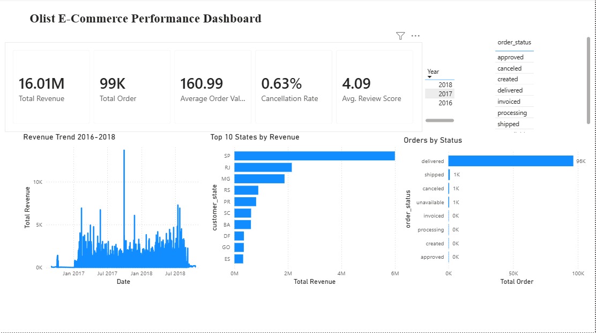

# Olist E-Commerce Performance Dashboard 📊

A Power BI dashboard analysing the Olist Brazilian E-Commerce dataset, covering customer behaviour, revenue trends, order performance, and regional sales distribution across 2016–2018.

---

## 📌 Project Overview

**Business Context:**
Olist is a Brazilian e-commerce marketplace connecting small businesses to customers across Brazil. This dashboard was built to help operations and sales teams monitor key business metrics, identify top-performing regions, and track order fulfilment quality.

**Tool Used:** Power BI Desktop  
**Dataset:** [Olist Brazilian E-Commerce Dataset](https://www.kaggle.com/datasets/olistbr/brazilian-ecommerce) — Kaggle  
**Data Period:** 2016 – 2018  

---

## 📂 Dataset Tables Used

| Table | Description |
|-------|-------------|
| `olist_orders_dataset` | Order-level data including status and timestamps |
| `olist_customers_dataset` | Customer location and ID data |
| `olist_order_payments_dataset` | Payment values and methods per order |
| `olist_order_items_dataset` | Products and freight per order |
| `olist_order_reviews_dataset` | Customer review scores and comments |

---

## 🗂️ Data Model (Star Schema)

```
Customers ──── Orders ──── Order_Items
                  │
            Order_Payments
                  │
            Order_Reviews
```

- **Fact Table:** Orders (central table connecting all dimensions)
- **Dimension Tables:** Customers, Order_Items, Order_Payments, Order_Reviews
- **Date Table:** Custom DAX CALENDAR table connected to order_purchase_timestamp

---

## 📐 DAX Measures Created

| Measure | Formula |
|---------|---------|
| Total Revenue | `SUM(Order_payments[payment_value])` |
| Total Orders | `DISTINCTCOUNT(Orders[order_id])` |
| Avg Order Value | `DIVIDE([Total Revenue], [Total Orders])` |
| Total Reviews | `COUNT(Order_reviews[review_id])` |
| Avg Review Score | `AVERAGE(Order_reviews[review_score])` |
| Delivered Orders | `CALCULATE([Total Orders], Orders[order_status] = "delivered")` |
| Cancelled Orders | `CALCULATE([Total Orders], Orders[order_status] = "cancelled")` |
| Cancellation Rate | `DIVIDE([Cancelled Orders], [Total Orders])` |

---

## 📊 Dashboard Features

### KPI Cards
- **Total Revenue:** R$16.01M
- **Total Orders:** 99K
- **Average Order Value:** R$160.99
- **Cancellation Rate:** 0.63%
- **Average Review Score:** 4.09 / 5

### Visuals
- 📈 **Revenue Trend 2016–2018** — Line chart showing monthly revenue growth with a clear peak in November 2017 (holiday season)
- 🗺️ **Top 10 States by Revenue** — Horizontal bar chart showing SP (São Paulo) as the dominant state at R$6M+
- 🔵 **Orders by Status** — Bar chart showing 97% of orders successfully delivered
- 🎛️ **Interactive Slicers** — Filter by Year (2016/2017/2018) and Order Status

---

## 💡 Key Insights

1. **São Paulo (SP) dominates revenue** — generating over R$6M, more than double the second-placed state (RJ at ~R$2.5M). Marketing investment should be maintained here.
2. **97% delivery success rate** — only 0.63% cancellation rate indicates strong operational performance.
3. **November 2017 revenue spike** — likely driven by Black Friday/holiday season promotions. Seasonal campaigns should be planned ahead of Q4.
4. **Average review score of 4.09/5** — customers are generally satisfied, suggesting product quality and delivery experience are strong.
5. **Revenue growth trend** — consistent upward trajectory from 2016 to mid-2018 indicates healthy business expansion.

---


## 🔗 Connect With Me

- **LinkedIn:** [linkedin.com/in/davidojenabor](https://linkedin.com/in/davidojenabor)
- **GitHub:** [github.com/Davidojenabor](https://github.com/Davidojenabor)

---
## Dashboard Preview




